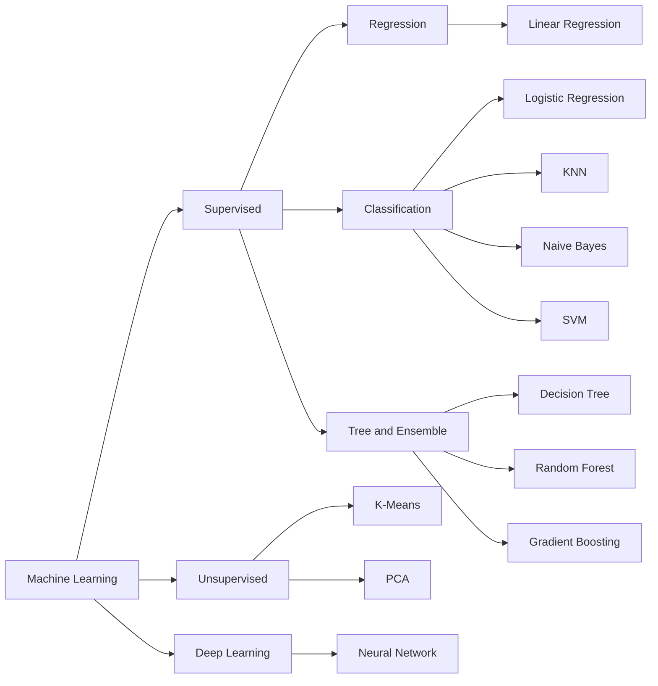
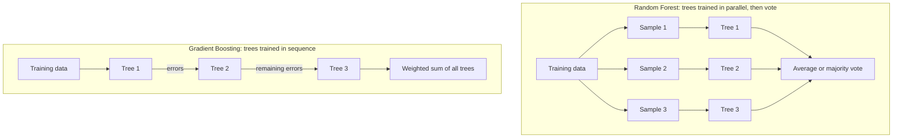
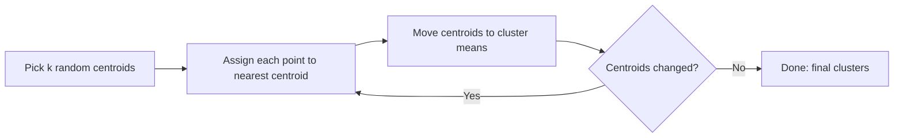
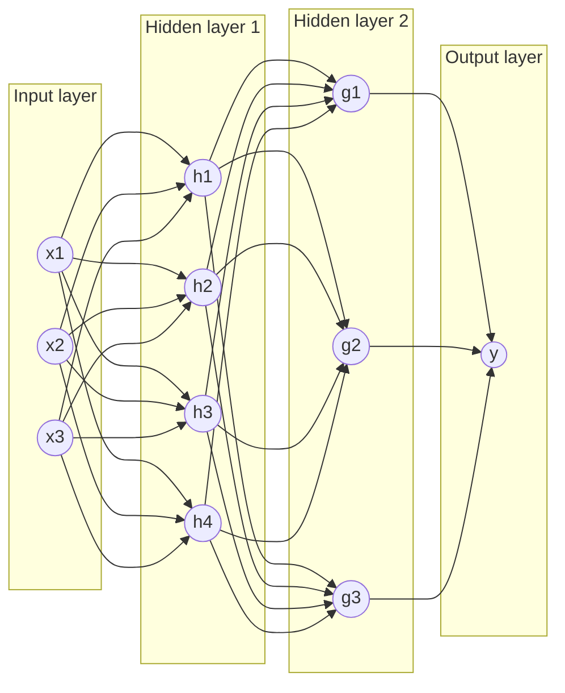
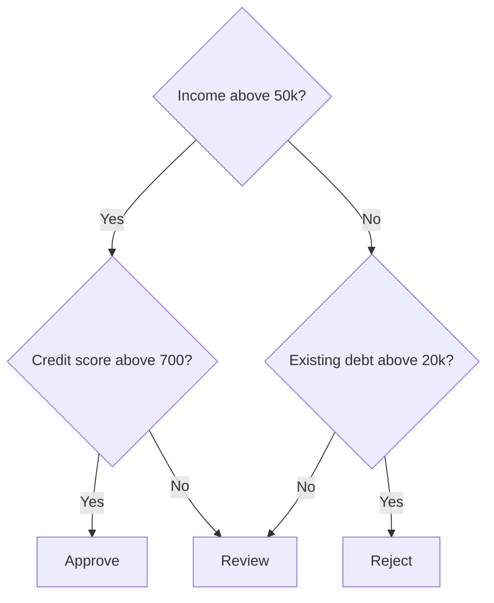
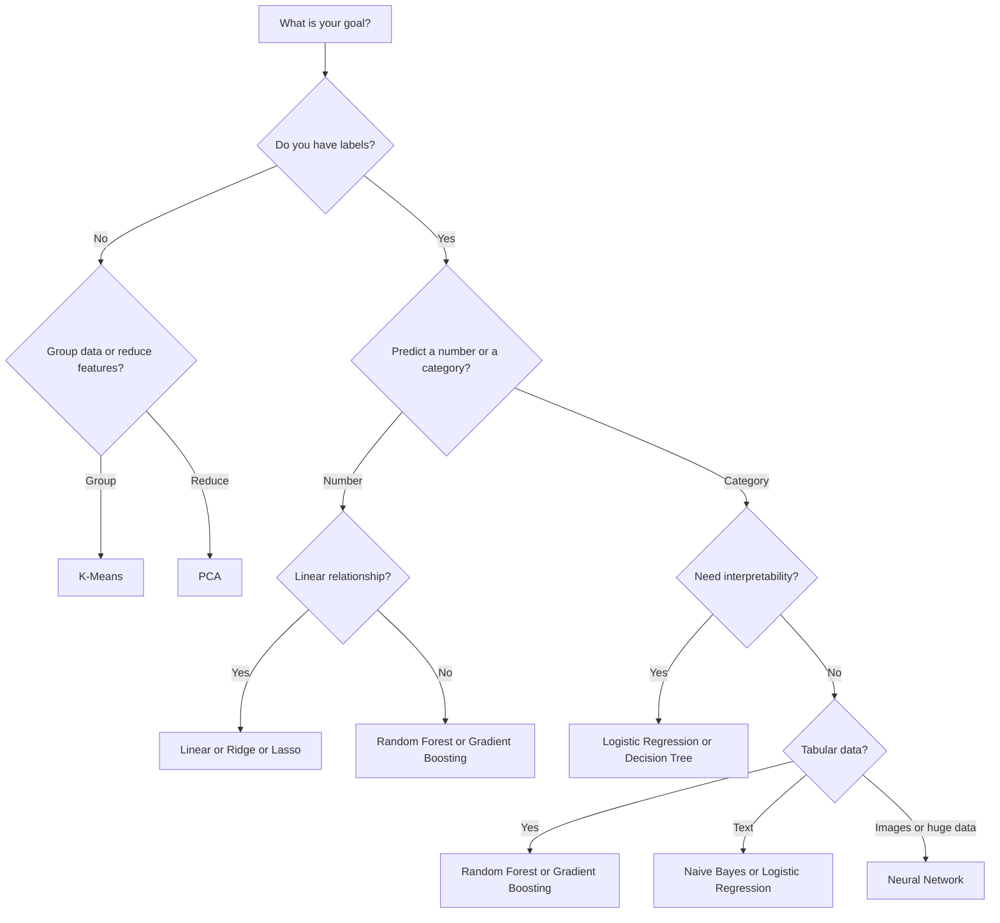
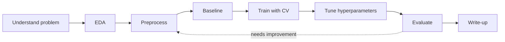

A hands-on collection of classic machine learning models implemented, explained, and benchmarked in Python. Each model has its own folder with a notebook, clean code, results, and a write-up of when to use it and when not to.

> **Goal:** build a practical, intuition-first understanding of the most important ML algorithms, from simple linear models to neural networks, and be able to choose the right one for a given problem.

---

## Table of Contents

1. [Project Goals](#project-goals)
2. [ML Landscape](#ml-landscape)
2. [Models Covered](#models-covered)
3. [Model Comparison at a Glance](#model-comparison-at-a-glance)
   - [Visual Intuition](#visual-intuition)
   - [Which Model Should I Use?](#which-model-should-i-use)
4. [Repository Structure](#repository-structure)
5. [Getting Started](#getting-started)
6. [Workflow Used for Every Model](#workflow-used-for-every-model)
7. [Evaluation Metrics](#evaluation-metrics)
8. [Datasets](#datasets)
9. [Roadmap](#roadmap)
10. [Contributing](#contributing)
11. [License](#license)

---

## Project Goals

- Implement each model with **scikit-learn** and, where useful, **from scratch with NumPy** to understand the math.
- Document **how each model works**, its **assumptions**, **pros**, and **cons**.
- Compare models on the same datasets using consistent metrics.
- Keep everything reproducible (fixed seeds, pinned requirements).

---

## ML Landscape



---

## Models Covered

### Supervised Learning: Regression

#### 1. Linear Regression
**What it is:** Fits a straight line (or hyperplane) that minimizes the squared error between predictions and actual values: `y = w·x + b`.

**How it works:** Finds weights using Ordinary Least Squares (closed form) or Gradient Descent.

**Typical use cases:** House price prediction, sales forecasting, trend analysis.

| Pros | Cons |
|------|------|
| Simple, fast, highly interpretable | Assumes a linear relationship |
| Works well on small datasets | Sensitive to outliers |
| Coefficients show feature impact | Suffers from multicollinearity |
| Great baseline model | Poor with complex, non-linear patterns |

**Variants planned:** Ridge (L2), Lasso (L1), Polynomial Regression.

---

### Supervised Learning: Classification

#### 2. Logistic Regression
**What it is:** A linear model for classification that outputs a probability using the sigmoid function: `P(y=1) = 1 / (1 + e^-(w·x + b))`.

**How it works:** Optimizes log-loss (cross-entropy) via gradient descent.

**Typical use cases:** Spam detection, churn prediction, medical diagnosis, fraud flags.

| Pros | Cons |
|------|------|
| Outputs calibrated probabilities | Linear decision boundary only |
| Fast, easy to train and interpret | Struggles with complex feature interactions |
| Regularization prevents overfitting | Needs feature scaling for best results |
| Strong baseline for binary problems | Sensitive to multicollinearity |

#### 3. K-Nearest Neighbors (KNN)
**What it is:** Classifies a point by majority vote of its *k* closest training points (or averages them for regression).

**How it works:** No training phase; stores the data and computes distances (Euclidean, Manhattan) at prediction time.

**Typical use cases:** Recommendation systems, simple pattern recognition, anomaly detection.

| Pros | Cons |
|------|------|
| Very simple, no training step | Slow predictions on large datasets |
| Non-linear decision boundaries | Needs feature scaling |
| Few assumptions about data | Hurt by high dimensionality (curse of dimensionality) |
| Works for classification and regression | Sensitive to noise and irrelevant features |

#### 4. Naive Bayes
**What it is:** A probabilistic classifier based on Bayes' theorem with the "naive" assumption that features are independent given the class.

**How it works:** Computes `P(class | features) ∝ P(class) · ∏ P(feature | class)`.

**Typical use cases:** Spam filtering, text classification, sentiment analysis.

| Pros | Cons |
|------|------|
| Extremely fast, scales to huge data | Independence assumption rarely true |
| Works well with small training sets | Poor probability estimates |
| Excellent for text/high-dimensional data | Struggles with correlated features |
| Handles multiple classes naturally | Zero-frequency issue (needs smoothing) |

#### 5. Support Vector Machine (SVM)
**What it is:** Finds the hyperplane that separates classes with the **maximum margin**. Kernels (RBF, polynomial) allow non-linear boundaries.

**How it works:** Uses support vectors (the points closest to the boundary) to define the decision surface; the kernel trick maps data into higher dimensions.

**Typical use cases:** Image classification, bioinformatics, text categorization, small/medium datasets.

| Pros | Cons |
|------|------|
| Effective in high-dimensional spaces | Slow on very large datasets |
| Memory efficient (uses support vectors) | Needs careful tuning (C, gamma, kernel) |
| Flexible via kernels | Requires feature scaling |
| Robust with clear margin of separation | No direct probability outputs |

---

### Tree-Based and Ensemble Models

#### 6. Decision Tree
**What it is:** A flowchart-like model that splits data on feature thresholds to make predictions.

**How it works:** Recursively chooses splits that maximize information gain or minimize Gini impurity.

**Typical use cases:** Credit approval, rule-based decisions, explainable predictions.

| Pros | Cons |
|------|------|
| Easy to visualize and explain | Prone to overfitting |
| No feature scaling needed | Unstable (small data changes alter the tree) |
| Handles numeric and categorical data | Biased toward dominant classes |
| Captures non-linear relationships | Axis-aligned splits only |

#### 7. Random Forest
**What it is:** An ensemble of many decision trees trained on random subsets of data and features; predictions are averaged or voted.

**How it works:** Bagging (bootstrap aggregation) plus random feature selection reduces variance.

**Typical use cases:** Tabular data, feature importance analysis, intrusion/fraud detection.

| Pros | Cons |
|------|------|
| High accuracy, robust to overfitting | Less interpretable than a single tree |
| Handles missing values and outliers well | Larger memory and slower inference |
| Provides feature importance | Can underperform on very sparse data |
| Minimal tuning needed | Not great at extrapolation |

#### 8. Gradient Boosting (XGBoost / LightGBM)
**What it is:** Builds trees sequentially, where each new tree corrects the errors of the previous ones.

**How it works:** Fits trees to the negative gradient of the loss function, with a learning rate controlling each step.

**Typical use cases:** Kaggle-style tabular competitions, ranking, risk scoring.

| Pros | Cons |
|------|------|
| Often state-of-the-art on tabular data | Many hyperparameters to tune |
| Handles mixed feature types and missing values | Can overfit if not regularized |
| Built-in regularization (XGBoost) | Sequential training is slower than RF |
| Flexible loss functions | Harder to interpret |

---

### Unsupervised Learning

#### 9. K-Means Clustering
**What it is:** Partitions data into *k* clusters by assigning points to the nearest centroid and updating centroids iteratively.

**How it works:** Minimizes within-cluster sum of squares (inertia). Choose *k* with the elbow method or silhouette score.

**Typical use cases:** Customer segmentation, image compression, grouping similar behaviors.

| Pros | Cons |
|------|------|
| Simple, fast, scalable | Must specify *k* in advance |
| Easy to interpret clusters | Assumes spherical, similarly sized clusters |
| Works well on clean numeric data | Sensitive to initialization and outliers |
| Good starting point for exploration | Needs feature scaling |

#### 10. Principal Component Analysis (PCA)
**What it is:** A dimensionality reduction technique that projects data onto the directions of maximum variance.

**How it works:** Computes eigenvectors of the covariance matrix (or uses SVD) and keeps the top components.

**Typical use cases:** Visualization, noise reduction, speeding up other models, removing correlated features.

| Pros | Cons |
|------|------|
| Reduces dimensionality and noise | Components are hard to interpret |
| Removes feature correlation | Only captures linear structure |
| Speeds up downstream training | Requires scaling; sensitive to outliers |
| Helps visualize high-dimensional data | Some information is always lost |

---

### Deep Learning

#### 11. Neural Network (Multi-Layer Perceptron)
**What it is:** Layers of connected neurons that learn non-linear transformations of input data.

**How it works:** Forward pass computes predictions; backpropagation with gradient descent updates weights. Built with TensorFlow/Keras or PyTorch.

**Typical use cases:** Complex tabular problems, pattern recognition, a foundation for CNNs/RNNs.

| Pros | Cons |
|------|------|
| Learns highly complex non-linear patterns | Needs lots of data |
| Flexible architectures | Computationally expensive |
| Scales with data and compute | Black box, hard to interpret |
| Basis for modern deep learning | Many hyperparameters; easy to overfit |

**Planned extensions:** Convolutional Neural Network (image classification on MNIST/CIFAR-10).

---

## Model Comparison at a Glance

| Model | Type | Interpretability | Training Speed | Needs Scaling | Handles Non-linearity |
|-------|------|:---:|:---:|:---:|:---:|
| Linear Regression | Regression | High | Very fast | Helpful | No |
| Logistic Regression | Classification | High | Very fast | Yes | No |
| KNN | Both | Medium | None (slow predict) | Yes | Yes |
| Naive Bayes | Classification | Medium | Very fast | No | Limited |
| SVM | Both | Low | Slow on large data | Yes | Yes (kernels) |
| Decision Tree | Both | High | Fast | No | Yes |
| Random Forest | Both | Medium | Medium | No | Yes |
| Gradient Boosting | Both | Low | Medium | No | Yes |
| K-Means | Clustering | Medium | Fast | Yes | No |
| PCA | Dim. reduction | Low | Fast | Yes | No |
| Neural Network | Both | Very low | Slow | Yes | Yes |

---

## Visual Intuition

### Bagging vs Boosting (Random Forest vs Gradient Boosting)



### K-Means Loop



### Neural Network (MLP)



Training loop: forward pass, compute loss, backpropagate gradients, update weights, repeat.

### Decision Tree Example



---

## Which Model Should I Use?



---

## Repository Structure

```
MACHINE-LEARNING-MODELS/
├── data/                      # Datasets (small ones) or download scripts
├── models/
│   ├── 01_linear_regression/
│   │   ├── notebook.ipynb
│   │   ├── model.py
│   │   └── README.md          # Model-specific notes and results
│   ├── 02_logistic_regression/
│   ├── 03_knn/
│   ├── ...
├── utils/                     # Shared preprocessing and plotting helpers
├── results/                   # Saved metrics, plots, comparison tables
├── requirements.txt
├── LICENSE
└── README.md
```

---

## Getting Started

```bash
git clone https://github.com/Nihar16/MACHINE-LEARNING-MODELS.git
cd MACHINE-LEARNING-MODELS
```

Then run the setup script for your OS. It checks Python, creates a virtual environment, installs dependencies, and registers a Jupyter kernel.

| OS | Command |
|----|---------|
| macOS / Linux | `chmod +x setup.sh && ./setup.sh` |
| Windows (PowerShell) | `.\setup.ps1` |
| Windows (double-click) | `setup.bat` |

Add `--launch` (macOS/Linux) or `-Launch` (PowerShell) to open Jupyter when setup finishes.

<details>
<summary>Manual setup</summary>

```bash
python -m venv venv
source venv/bin/activate        # Windows: venv\Scripts\activate
pip install -r requirements.txt
jupyter notebook
```

</details>

**Core libraries:** NumPy, pandas, scikit-learn, matplotlib, seaborn, XGBoost, TensorFlow/PyTorch, Jupyter.

---

## Workflow Used for Every Model



1. **Problem and data understanding:** goal, features, target.
2. **Exploratory data analysis:** distributions, correlations, missing values.
3. **Preprocessing:** cleaning, encoding, scaling, train/test split.
4. **Baseline model:** a simple reference to beat.
5. **Training:** with cross-validation.
6. **Hyperparameter tuning:** GridSearchCV / RandomizedSearchCV.
7. **Evaluation:** metrics, confusion matrix, error analysis.
8. **Write-up:** pros, cons, lessons learned.

---

## Evaluation Metrics

| Task | Metrics |
|------|---------|
| Regression | MAE, MSE, RMSE, R² |
| Classification | Accuracy, Precision, Recall, F1, ROC-AUC, Confusion Matrix |
| Clustering | Silhouette Score, Inertia, Davies-Bouldin Index |
| Dimensionality Reduction | Explained Variance Ratio |

> Accuracy alone is misleading on imbalanced data; precision, recall, and F1 are prioritized there.

---

## Datasets

| Dataset | Used For |
|---------|----------|
| California Housing | Regression models |
| Iris | Classification basics, KNN, SVM, clustering |
| Breast Cancer Wisconsin | Binary classification, model comparison |
| Titanic | Tree-based models, feature engineering |
| MNIST | Neural networks, PCA visualization |
| Mall Customers | K-Means segmentation |
| NSL-KDD / CICIDS2017 *(optional)* | Applied security: intrusion/anomaly detection |

---

## Roadmap

- [ ] Linear and Logistic Regression
- [ ] KNN and Naive Bayes
- [ ] Decision Tree and Random Forest
- [ ] SVM
- [ ] Gradient Boosting (XGBoost / LightGBM)
- [ ] K-Means and PCA
- [ ] Neural Network (MLP)
- [ ] CNN for image classification
- [ ] Final model comparison report
- [ ] Applied security project (network intrusion detection)

---

## Contributing

Suggestions and improvements are welcome. Open an issue to discuss a change, or submit a pull request.

---

## License

Distributed under the **MIT License**. See [`LICENSE`](LICENSE) for details.

---

**Author:** [Nihar Mane](https://github.com/Nihar16)
