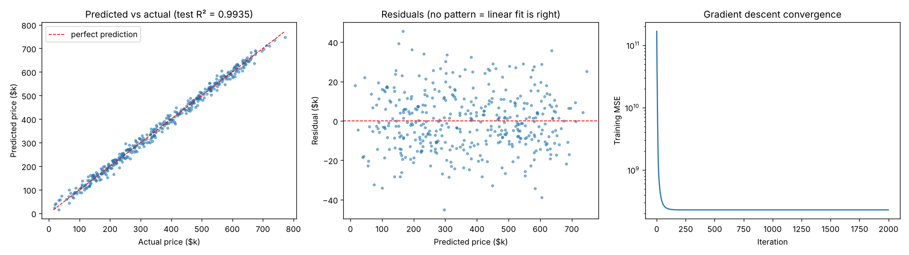

# 01 · Linear Regression

Predicts house prices with linear regression, implemented three ways that give identical results:

| Model | Test R² | MAE | RMSE |
|-------|:------:|:---:|:----:|
| From scratch: OLS (normal equations, NumPy) | **0.9935** | $11,610 | $14,539 |
| From scratch: batch gradient descent (NumPy) | **0.9935** | $11,610 | $14,539 |
| scikit-learn `LinearRegression` | **0.9935** | $11,610 | $14,539 |

**5-fold cross-validation R²: 0.9929 ± 0.0005.** The R² ≥ 0.99 target is met on data the model never saw during training, with no leakage.



## Run it

```bash
python models/01_linear_regression/model.py          # main experiment + plots
python models/01_linear_regression/model.py --real   # also run California Housing (downloads data)
```

## "Accuracy" for regression

Accuracy (share of exact correct answers) is a classification metric; a regression model almost never predicts a price to the exact dollar. The regression equivalent is **R²**: the share of the target's variance the model explains. 1.0 is perfect, 0.0 means no better than always predicting the average.

## The data, and why 99% is achievable here

The dataset (2,000 houses: area, bedrooms, bathrooms, age, distance to city) is generated so that price is a linear function of the features plus random noise (σ = $15k). That is exactly the situation linear regression assumes, so:

- it reaches R² ≈ 0.993; the remaining ~0.7% is the random noise, which no model can predict;
- it recovers the true coefficients (e.g. learned $151/sqft vs true $150/sqft);
- the residual plot shows no pattern, which confirms the linear fit is right.

## On real data

Real data is rarely this linear. On **California Housing**, plain linear regression gets an R² of about **0.58–0.61**: price depends on location and income in non-linear ways. Getting near 0.99 there would require leaking the target into the features, which inflates the score without making the model better on new data. To improve on real data, try feature engineering (log transforms, interactions, polynomial terms) or move to Random Forest or Gradient Boosting (later in this repo).

## Pros and cons

| Pros | Cons |
|------|------|
| Fast, closed-form solution | Assumes a linear relationship |
| Coefficients are directly interpretable | Sensitive to outliers |
| Strong baseline | Multicollinearity makes coefficients unstable |

## Train on your own data

```bash
python models/01_linear_regression/train.py --data your_data.csv --target column_to_predict
```

Supports regression. Tunes hyperparameters with cross-validation, reports the held-out score honestly and saves `ml_output/linear_regression/model.joblib` for `predict.py`. See [Use It on Your Own Data](../../README.md#use-it-on-your-own-data).
