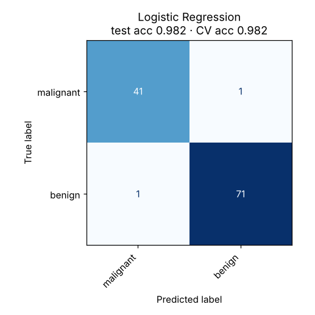

# 02 · Logistic Regression

**Dataset:** Breast Cancer Wisconsin: 569 tumours, 30 measurements, malignant vs benign.

| Metric | Value |
|---|---|
| CV accuracy (5-fold, train) | 98.2% ± 0.5% |
| Test accuracy (held-out 20%) | 98.2% (2 of 114 wrong) |
| Test F1 (macro) | 0.981 |
| Test ROC-AUC | 0.996 |
| Best hyperparameters | `{"clf__C": 0.1, "clf__penalty": "l2", "clf__solver": "liblinear"}` |



## Notes

Scaling plus L2 regularization (C=0.1) gives a strong, interpretable baseline. ROC-AUC is about 0.996, so the model ranks tumours almost perfectly; the remaining errors are borderline cases near the decision boundary. In a medical setting, recall on malignant cases matters more than raw accuracy.

Moving past about 98% would need richer data, since a linear boundary is already close to what this dataset supports.

## Run

```bash
python models/02_logistic_regression/model.py
```

## Train on your own data

```bash
python models/02_logistic_regression/train.py --data your_data.csv --target column_to_predict
```

Supports classification. Tunes hyperparameters with cross-validation, reports the held-out score honestly and saves `ml_output/logistic_regression/model.joblib` for `predict.py`. See [Use It on Your Own Data](../../README.md#use-it-on-your-own-data).
