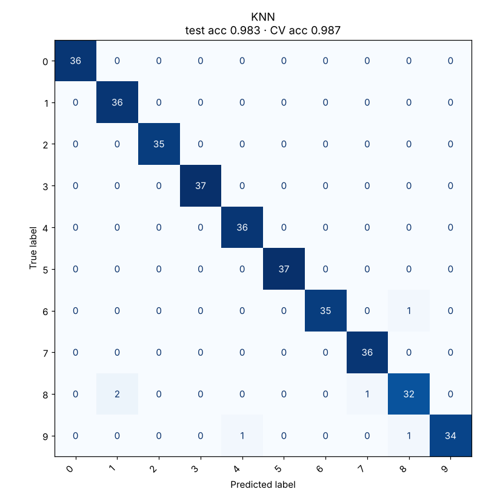

# 03 · K-Nearest Neighbors

**Dataset:** Digits: 1,797 handwritten digits, 8x8 pixels (64 features), 10 classes.

| Metric | Value |
|---|---|
| CV accuracy (5-fold, train) | 98.7% ± 0.8% |
| Test accuracy (held-out 20%) | 98.3% (6 of 360 wrong) |
| Test F1 (macro) | 0.983 |
| Best hyperparameters | `{"n_neighbors": 5, "p": 2, "weights": "uniform"}` |



## Notes

Pixels share one scale, so the model uses raw distances. Scaling hurt here because it boosts the near-empty border pixels. The 6 test errors are between similar-looking digits; the most common is an 8 read as a 1 (twice).

On full-size MNIST (28x28), KNN typically reaches about 97%.

## Run

```bash
python models/03_knn/model.py
```

## Train on your own data

```bash
python models/03_knn/train.py --data your_data.csv --target column_to_predict
```

Supports classification and regression. Tunes hyperparameters with cross-validation, reports the held-out score honestly and saves `ml_output/knn/model.joblib` for `predict.py`. See [Use It on Your Own Data](../../README.md#use-it-on-your-own-data).
