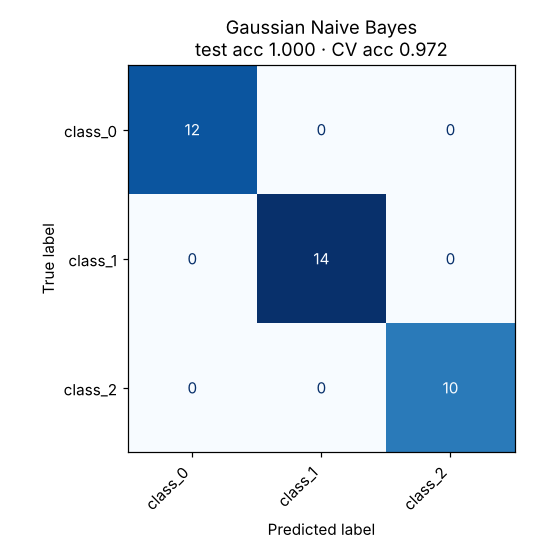

# 04 · Gaussian Naive Bayes

**Dataset:** Wine: 178 wines, 13 chemical measurements, 3 cultivars.

| Metric | Value |
|---|---|
| CV accuracy (5-fold, train) | 97.2% ± 2.6% |
| Test accuracy (held-out 20%) | 100.0% (0 of 36 wrong) |
| Test F1 (macro) | 1.000 |
| Best hyperparameters | `{"clf__var_smoothing": 1e-09, "transform": "PowerTransformer()"}` |



## Notes

A power transform makes the features closer to Gaussian, which is the assumption GaussianNB relies on. The 100% test score comes from only 36 samples, so a single mistake would be 2.8%. The cross-validation score of 97.2% ± 2.6% is the honest estimate.

Naive Bayes is at its strongest on text, such as spam filtering, where word counts suit Multinomial NB.

## Run

```bash
python models/04_naive_bayes/model.py
```

## Train on your own data

```bash
python models/04_naive_bayes/train.py --data your_data.csv --target column_to_predict
```

Supports classification. Tunes hyperparameters with cross-validation, reports the held-out score honestly and saves `ml_output/naive_bayes/model.joblib` for `predict.py`. See [Use It on Your Own Data](../../README.md#use-it-on-your-own-data).
