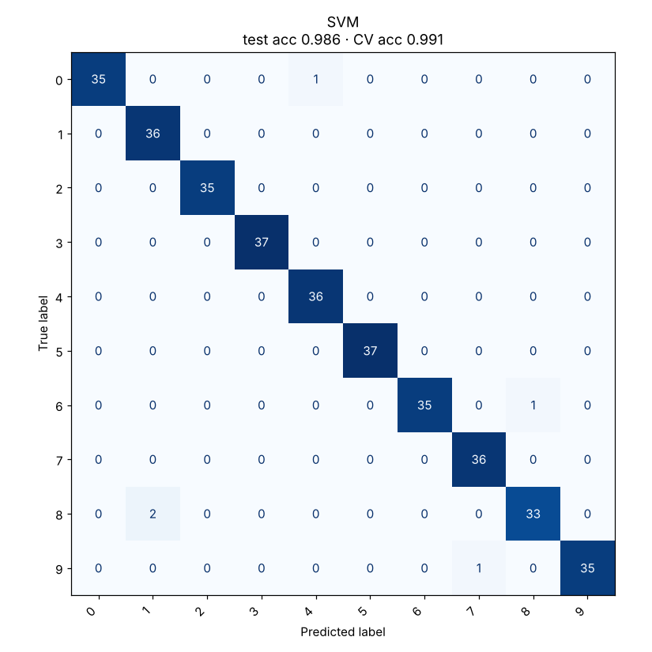

# 05 · Support Vector Machine

**Dataset:** Digits: 1,797 handwritten digits, 64 features, 10 classes.

| Metric | Value |
|---|---|
| CV accuracy (5-fold, train) | 99.1% ± 0.3% |
| Test accuracy (held-out 20%) | 98.6% (5 of 360 wrong) |
| Test F1 (macro) | 0.986 |
| Best hyperparameters | `{"C": 1, "degree": 3, "gamma": "scale", "kernel": "poly"}` |



## Notes

Grid search compared RBF and polynomial kernels; a degree-3 polynomial kernel won. This is the strongest model in the repo on real data, with 99.1% cross-validation accuracy. The held-out test score is 98.6%, with 5 errors out of 360.

Both numbers are reported because 99% on CV alone could be luck in fold selection; together they put the true accuracy at roughly 98.6 to 99.1%.

## Run

```bash
python models/05_svm/model.py
```
