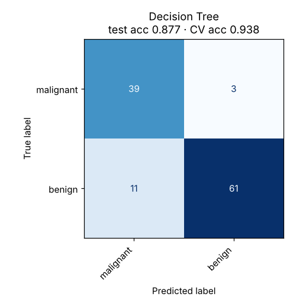

# 06 · Decision Tree

**Dataset:** Breast Cancer Wisconsin: 569 tumours, 30 features.

| Metric | Value |
|---|---|
| CV accuracy (5-fold, train) | 93.8% ± 1.9% |
| Test accuracy (held-out 20%) | 87.7% (14 of 114 wrong) |
| Test F1 (macro) | 0.872 |
| Test ROC-AUC | 0.959 |
| Best hyperparameters | `{"ccp_alpha": 0.0, "criterion": "entropy", "max_depth": 4, "min_samples_leaf": 5}` |



## Notes

Pruning (max depth 4, at least 5 samples per leaf) keeps the tree readable, and the script prints its rules. A single tree is the weakest model here: test accuracy is 87.7% against 93.8% in cross-validation. That gap shows the instability the README warns about, since small changes in the data produce a different tree.

Random Forest and Gradient Boosting exist to fix exactly this, by averaging or boosting many trees.

## Run

```bash
python models/06_decision_tree/model.py
```

## Train on your own data

```bash
python models/06_decision_tree/train.py --data your_data.csv --target column_to_predict
```

Supports classification and regression. Tunes hyperparameters with cross-validation, reports the held-out score honestly and saves `ml_output/decision_tree/model.joblib` for `predict.py`. See [Use It on Your Own Data](../../README.md#use-it-on-your-own-data).
