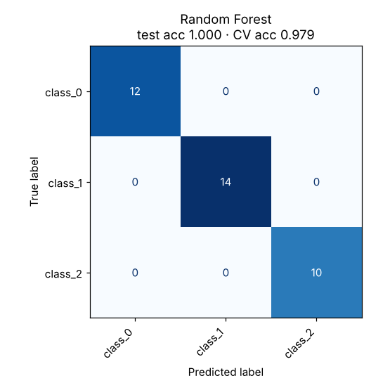

# 07 · Random Forest

**Dataset:** Wine: 178 wines, 13 features, 3 cultivars.

| Metric | Value |
|---|---|
| CV accuracy (5-fold, train) | 97.9% ± 2.8% |
| Test accuracy (held-out 20%) | 100.0% (0 of 36 wrong) |
| Test F1 (macro) | 1.000 |
| Best hyperparameters | `{"max_features": "sqrt", "min_samples_leaf": 1, "n_estimators": 300}` |



## Notes

300 trees with sqrt feature sampling. The 100% test score comes from only 36 samples, so the cross-validation score of 97.9% ± 2.8% is the honest estimate. The script also prints feature importances; colour intensity, flavanoids and proline dominate.

## Run

```bash
python models/07_random_forest/model.py
```

## Train on your own data

```bash
python models/07_random_forest/train.py --data your_data.csv --target column_to_predict
```

Supports classification and regression. Tunes hyperparameters with cross-validation, reports the held-out score honestly and saves `ml_output/random_forest/model.joblib` for `predict.py`. See [Use It on Your Own Data](../../README.md#use-it-on-your-own-data).
