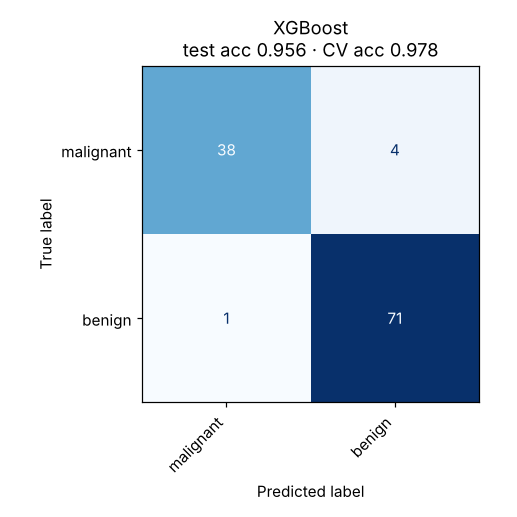

# 08 · Gradient Boosting (XGBoost / LightGBM)

**Dataset:** Breast Cancer Wisconsin: 569 tumours, 30 features.

| Metric | Value |
|---|---|
| CV accuracy (5-fold, train) | 97.8% ± 1.6% |
| Test accuracy (held-out 20%) | 95.6% (5 of 114 wrong) |
| Test F1 (macro) | 0.952 |
| Test ROC-AUC | 0.995 |
| Best hyperparameters | `{"learning_rate": 0.1, "max_depth": 3, "n_estimators": 400}` |



## Notes

XGBoost reached 97.8% in cross-validation and LightGBM 97.4%; both have ROC-AUC of about 0.99. The headline model is chosen by its cross-validation score, never by its test score. On this small, nearly linear dataset, boosting does not beat Logistic Regression. Boosting tends to win on larger tabular data with non-linear interactions.

Per-library results are in `xgboost/results/` and `lightgbm/results/`.

## Run

```bash
python models/08_gradient_boosting/model.py
```

## Train on your own data

```bash
python models/08_gradient_boosting/train.py --data your_data.csv --target column_to_predict
```

Supports classification and regression. Tunes hyperparameters with cross-validation, reports the held-out score honestly and saves `ml_output/gradient_boosting/model.joblib` for `predict.py`. See [Use It on Your Own Data](../../README.md#use-it-on-your-own-data).
