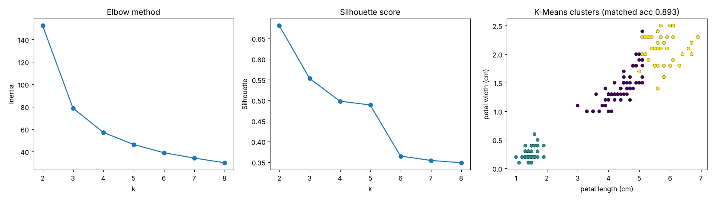

# 09 · K-Means Clustering

**Dataset:** Iris: 150 flowers, 4 measurements, 3 species (labels used only for evaluation).

| Metric | Value |
|---|---|
| Matched accuracy | 89.3% |
| Adjusted Rand Index | 0.730 |
| Silhouette | 0.553 |



## Notes

The elbow method points to k=3. The silhouette score peaks at k=2, because setosa separates cleanly while versicolor and virginica overlap. With k=3, the clusters match the species for 89.3% of flowers. Setosa is grouped perfectly; the errors are all in the versicolor/virginica overlap.

No unsupervised method can reach 99% here, because the two overlapping species are not separate clusters in the data.

## Run

```bash
python models/09_kmeans/model.py
```

## Cluster your own data

```bash
python models/09_kmeans/train.py --data your_data.csv            # k chosen by silhouette score
python models/09_kmeans/train.py --data your_data.csv --k 4 --target label   # label used only to score clusters
```

Writes `ml_output/kmeans/clusters.csv` with a `cluster` column for every row.
