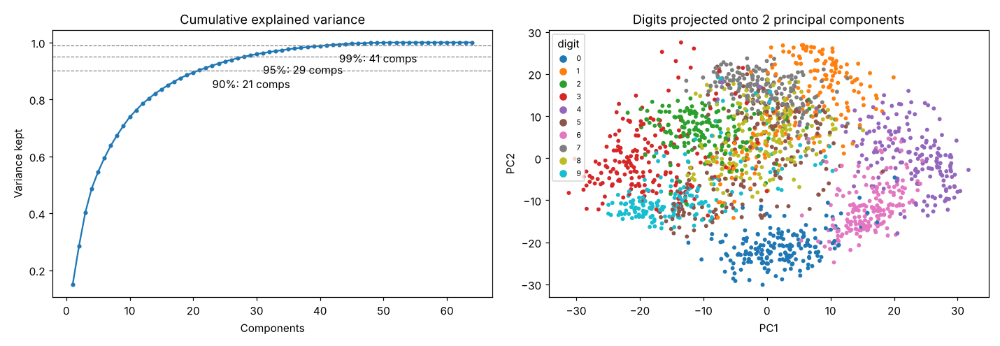

# 10 · Principal Component Analysis

**Dataset:** Digits: 1,797 images, 64 pixel features.

| Setting | SVM CV accuracy |
|---|---|
| all 64 features | 99.1% |
| PCA 21 comp (90% var) | 99.1% |
| PCA 29 comp (95% var) | 99.2% |
| PCA 41 comp (99% var) | 99.1% |



## Notes

41 of 64 components keep 99% of the variance, and 21 components keep 90%. An SVM trained on 29 components (95% variance) scores 99.2% in cross-validation, matching or slightly beating all 64 features. That means PCA removed about half the features without losing accuracy. PCA is refitted inside each fold, so nothing leaks.

## Run

```bash
python models/10_pca/model.py
```
