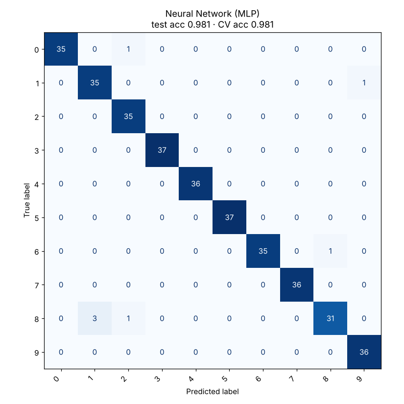

# 11 · Neural Network (MLP)

**Dataset:** Digits: 1,797 handwritten digits, 64 features, 10 classes.

| Metric | Value |
|---|---|
| CV accuracy (5-fold, train) | 98.1% ± 0.9% |
| Test accuracy (held-out 20%) | 98.1% (7 of 360 wrong) |
| Test F1 (macro) | 0.980 |
| Best hyperparameters | `{"mlp__alpha": 0.0001, "mlp__hidden_layer_sizes": [256]}` |



## Notes

The best network has one hidden layer of 256 units, scoring 98.1% in cross-validation and 98.1% on the test set. Adding a second layer or stronger regularization did not help on a dataset this small.

Image models clear 99% with convolutional networks, which are planned in the README roadmap. A small CNN on MNIST reaches about 99.3%.

## Run

```bash
python models/11_neural_network/model.py
```

## Train on your own data

```bash
python models/11_neural_network/train.py --data your_data.csv --target column_to_predict
```

Supports classification and regression. Tunes hyperparameters with cross-validation, reports the held-out score honestly and saves `ml_output/neural_network/model.joblib` for `predict.py`. See [Use It on Your Own Data](../../README.md#use-it-on-your-own-data).
