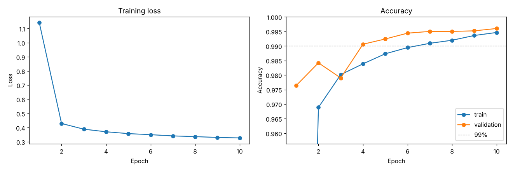
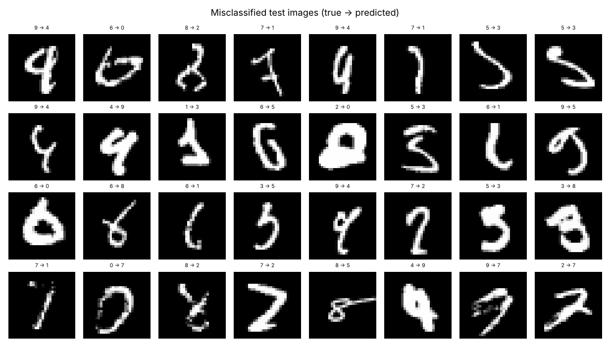
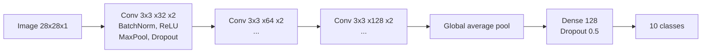

# 12 · Convolutional Neural Network (CNN)

**Dataset:** MNIST, 70,000 handwritten digits (28x28 grayscale, 10 classes). This is the real benchmark, not a synthetic one.

| Metric | Value |
|---|---|
| **Test accuracy (official 10,000-image test set)** | **99.67%** (33 of 10,000 wrong) |
| Validation accuracy (5,000 images, picks the best epoch) | 99.60% |
| Parameters | 304,682 |
| Training | 10 epochs, about 9 minutes on a 4-core CPU (seconds per epoch on a GPU) |

The test images are never used for training or for choosing the epoch, so 99.67% is an honest estimate on unseen digits.





Most of the 33 errors are digits a person could misread too, such as a 9 that looks like a 4, or a 6 drawn as a loop.

## How it works



- **Convolutions** learn small local patterns such as edges and strokes, and stack them into shapes. Unlike the MLP in `11_neural_network`, they know that neighbouring pixels belong together.
- **Pooling** shrinks the image so later layers see larger parts of the digit.
- **Batch normalization and dropout** keep training stable and limit overfitting.
- **Augmentation** applies random small rotations, shifts and zooms. This is the main reason the CNN beats 99%, because it learns that a tilted 7 is still a 7. It is also why training accuracy sits below validation accuracy: training images are harder on purpose.
- **AdamW with a one-cycle learning rate** and label smoothing. The loss floor of about 0.33 comes from label smoothing, not underfitting.

| Pros | Cons |
|------|------|
| State of the art for images | Needs more data and compute than classic models |
| Learns features automatically, no hand-crafting | Hard to interpret |
| Robust to small shifts and distortions | Many design choices (layers, augmentation, learning rate) |

## Run the benchmark

```bash
pip install torch torchvision
python models/12_cnn/model.py              # downloads MNIST into data/, trains 10 epochs
python models/12_cnn/model.py --epochs 3   # quick check
```

## Train on your own images

Put one folder per class, or use `train/` and `test/` sub-folders to supply your own split:

```
my_images/
    cats/   img001.jpg  img002.png ...
    dogs/   ...
```

```bash
python models/12_cnn/train.py --data my_images                               # small CNN from scratch, 64x64
python models/12_cnn/train.py --data my_images --arch resnet18 --pretrained  # transfer learning, 224x224
python models/12_cnn/predict.py --model ml_output/cnn/model.pt --images new_photos/ --out predictions.csv
```

- Images are split 70% train, 15% validation (to pick the best epoch) and 15% test (scored once, stratified by class). The run reports test accuracy, per-class precision and recall, a majority-class baseline, and whether `--target-score` (default 99%) was reached.
- **For photos, use `--arch resnet18 --pretrained`.** It starts from a network already trained on ImageNet, which usually beats training from scratch by a wide margin when you have hundreds rather than tens of thousands of images.
- Use `--channels 1` for grayscale, and `--no-flip` for digits or text, where a mirrored image means something different.
- With a small dataset, use a smaller `--batch-size` (e.g. 8–16) so the network gets enough updates per epoch.
- Whether 99% is reachable depends on the images. Clean, distinct classes like digits can reach it; visually similar classes, or a few dozen images per class, usually won't.
